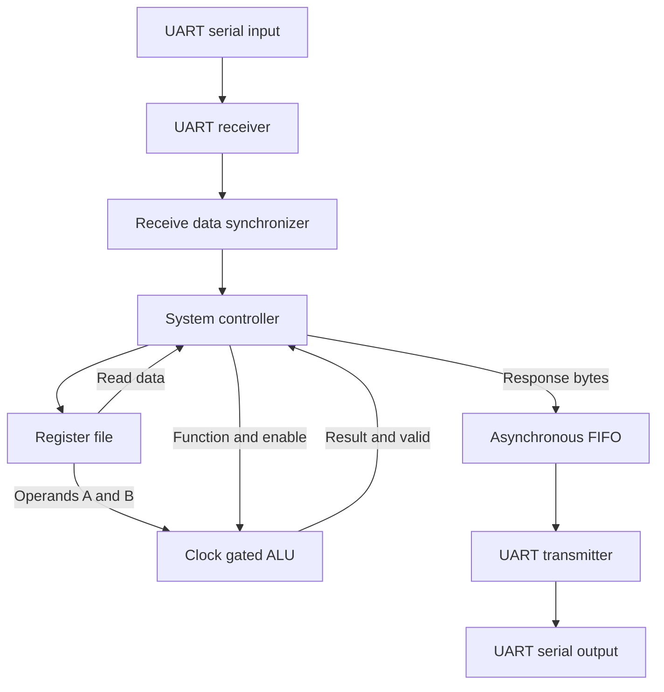

# UART-Controlled Digital System

A multi-clock digital system that receives commands over UART, executes register-file accesses or arithmetic and logic operations, and sends responses back over UART.

The project covers **Verilog RTL design, SystemVerilog verification, lint and CDC analysis, synthesis, formal equivalence checking, scan insertion, and physical implementation through GDS export**. Source files, scripts, reports, and implementation artifacts are included to document each stage.

**Author:** [Saeed Maher](https://github.com/saeedmaher)

[Detailed project documentation](UART_Controlled_System_Documentation.pdf) · [Simulation RTL](RTL/) · [Synthesis and DFT](Synthesis%20and%20DFT%20with%20relevent%20rtl/) · [Physical implementation](PnR/)

## Contents

- [Features](#features)
- [Architecture](#architecture)
- [Repository organization](#repository-organization)
- [Interfaces and configuration](#interfaces-and-configuration)
- [UART command protocol](#uart-command-protocol)
- [ALU operations](#alu-operations)
- [Simulation and verification](#simulation-and-verification)
- [Lint and CDC analysis](#lint-and-cdc-analysis)
- [Synthesis](#synthesis)
- [DFT and coverage](#dft-and-coverage)
- [Formal equivalence](#formal-equivalence)
- [Physical implementation](#physical-implementation)
- [Tools and reproduction](#tools-and-reproduction)
- [Limitations and follow-up work](#limitations-and-follow-up-work)

## Features

- 8-bit UART payload and processing operands with a 16-bit ALU result.
- 15 supported arithmetic, logical, comparison, and shift operations.
- A 16-entry, 8-bit register file containing operands, UART configuration, and general-purpose storage.
- Independent UART transmitter and receiver with optional even or odd parity.
- Receiver oversampling by 8, 16, or 32 with three-sample majority voting.
- A command-processing FSM supporting register reads/writes and ALU requests with new or stored operands.
- An 8-entry asynchronous FIFO for response buffering between processing and transmit clocks.
- Receive data synchronization, reset synchronization, and ALU clock gating.
- A separate DFT-ready RTL version with scan clock/reset selection and scan ports.

## Architecture

The system separates the processing clock domain from the UART clock domains.



### Main blocks

| Block | Responsibility |
| --- | --- |
| `SYS_TOP` | Integrates the complete system. |
| `SYS_CTRL` | Decodes command bytes, collects operands and addresses, controls execution, and enqueues responses. |
| `Register_File` | Stores operands, configuration fields, and general-purpose data. |
| `ALU` | Computes and registers a 16-bit result from two 8-bit operands. |
| `UART_TX` | Adds start, optional parity, and stop bits to an LSB-first serial payload. |
| `UART_RX` | Samples incoming bits, reconstructs bytes, and checks start, parity, and stop conditions. |
| `DATA_SYNC` | Transfers a stable receive byte and its valid event to the processing domain. |
| `FIFO_top` | Buffers response bytes using binary/Gray pointers and pointer synchronizers. |
| `Integer_CLK_DIV` | Generates the transmit bit clock and receiver sampling clock. |
| `CLK_gate` | Enables ALU clock activity during execution-related controller states. |
| `RST_SYNC` | Provides asynchronous reset assertion and synchronized release at the root clocks. |
| `Pulse_generator` | Generates local rising-edge events for receive capture and transmit FIFO dequeue. |

### Clocking

| Clock | Default behavior |
| --- | --- |
| `REF_CLK` | 50 MHz processing clock in the specification and testbench. |
| `UART_CLK` | 3.6864 MHz UART source clock in the specification and testbench. |
| `TX_CLK` | `UART_CLK / REG3`; default division by 32 gives 115200 bit/s. |
| `RX_CLK` | Selected division of `UART_CLK` to maintain the configured oversampling rate. |
| Gated ALU clock | A gated version of `REF_CLK`. |

For the implemented RX divider mapping:

| RX prescale | RX divider | RX sampling frequency | Nominal receive bit rate |
| --- | --- | --- | --- |
| 32 | 1 | 3.6864 MHz | 115200 bit/s |
| 16 | 2 | 1.8432 MHz | 115200 bit/s |
| 8 | 4 | 0.9216 MHz | 115200 bit/s |

Changing RX prescale does not, by itself, change the receive bit rate in this integration. The ASIC constraint scripts use a different UART period; see [Synthesis](#synthesis).

## Repository organization

| Location | Contents |
| --- | --- |
| [`RTL/`](RTL/) | Behavioral simulation RTL, system testbench, randomization package, source list, and simulator scripts. |
| [`spyglass_reports/`](spyglass_reports/) | Lint/CDC reports, waiver files, project configuration, and SGDC constraints. |
| [`Synthesis and DFT with relevent rtl/rtl/`](Synthesis%20and%20DFT%20with%20relevent%20rtl/rtl/) | RTL snapshot used for synthesis. |
| [`Synthesis and DFT with relevent rtl/rtl_dft/`](Synthesis%20and%20DFT%20with%20relevent%20rtl/rtl_dft/) | DFT-ready RTL with test clock/reset muxes and scan interface. |
| [`Synthesis and DFT with relevent rtl/syn/`](Synthesis%20and%20DFT%20with%20relevent%20rtl/syn/) | Synthesis script, constraints, log, netlists, SDF/SDC, and QoR reports. |
| [`Synthesis and DFT with relevent rtl/DFT/`](Synthesis%20and%20DFT%20with%20relevent%20rtl/DFT/) | Scan insertion script, constraints, log, and DFT implementation reports/artifacts. |
| [`Synthesis and DFT with relevent rtl/formality_post_syn/`](Synthesis%20and%20DFT%20with%20relevent%20rtl/formality_post_syn/) | Post-synthesis equivalence scripts, guidance, logs, and point reports. |
| [`Synthesis and DFT with relevent rtl/formality_post_dft/`](Synthesis%20and%20DFT%20with%20relevent%20rtl/formality_post_dft/) | Post-DFT equivalence scripts, guidance, logs, and point reports. |
| [`PnR/`](PnR/) | Final Encounter database, GDS, timing summaries, and power report. |
| [`UART_Controlled_System_Documentation.pdf`](UART_Controlled_System_Documentation.pdf) | Detailed design and verification documentation, including waveform figures. |

The RTL directories represent different flow snapshots. Use `RTL/` for the supplied behavioral simulation rather than combining all copies into one compilation.

## Interfaces and configuration

### Functional top-level interface

The synthesizable top module is `SYS_TOP` in `system_top.v`.

| Port | Direction | Description |
| --- | --- | --- |
| `RST_N` | Input | Active-low global reset. |
| `REF_CLK` | Input | Processing reference clock. |
| `UART_CLK` | Input | UART source clock. |
| `UART_RX_IN` | Input | Incoming serial command stream; idle high. |
| `UART_TX_OUT` | Output | Outgoing serial response stream; idle high. |
| `parity_error` | Output | Receiver parity-error indication. |
| `stop_error` | Output | Receiver stop-bit-error indication. |

The DFT-ready top additionally exposes `SCAN_CLK`, `SCAN_RST`, `SE`, `test_mode`, `SI[3:0]`, and `SO[3:0]`. Its test-mode muxes bypass functional clock and reset paths. Scan stitching is performed during DFT insertion.

### Register map

| Address | Purpose | Reset value |
| --- | --- | --- |
| `0x0` | ALU operand A | `0x00` |
| `0x1` | ALU operand B | `0x00` |
| `0x2` | UART configuration | `0x81` |
| `0x3` | Transmit clock division ratio | `0x20` |
| `0x4`–`0xF` | General-purpose registers | `0x00` |

`REG2` is decoded as follows:

| Bits | Meaning | Default |
| --- | --- | --- |
| `[0]` | Parity enable | 1 |
| `[1]` | Parity type: 0 even, 1 odd | 0 |
| `[7:2]` | RX oversampling prescale | 32 |

The implemented register address is four bits. Reserved registers are writable; there is no hardware protection against changing configuration or operands.

## UART command protocol

Each command field is sent as a separate UART frame:

**Start bit `0` → 8 data bits, LSB first → optional parity → stop bit `1`.**

Default framing is 8 data bits, even parity, and one stop bit at a nominal 115200 bit/s.

| Command byte | Operation | Following payload bytes | Response payload |
| --- | --- | --- | --- |
| `0xAA` | Register write | Address, data | None |
| `0xBB` | Register read | Address | One byte |
| `0xCC` | ALU using new operands | A, B, function | Low result byte, then high result byte |
| `0xDD` | ALU using stored operands | Function | Low result byte, then high result byte |

Example transactions, shown as hexadecimal UART payload bytes:

| Request | Meaning | Response |
| --- | --- | --- |
| `AA 05 55` | Write `0x55` to register `0x5`. | No acknowledgement. |
| `BB 05` | Read register `0x5`. | `55` |
| `CC 0C 03 00` | Add 12 and 3. | `0F 00` |
| `DD 02` | Multiply the stored operands 12 and 3. | `24 00` |

Reconstruct an ALU result as `(high_byte << 8) | low_byte`. Each response byte has its own UART framing and parity.

Only the low four bits of address and function bytes are used. The command interface has no receive queue, packet checksum, timeout, or ready signal; the sender must respect command completion and avoid overrunning the parser.

## ALU operations

Operands are unsigned 8-bit values. Results are registered in a 16-bit output.

| Function | Operation | Result |
| --- | --- | --- |
| `0x0` | Add | `A + B` |
| `0x1` | Subtract | `A - B` in the 16-bit result context |
| `0x2` | Multiply | Full product |
| `0x3` | Divide | Unsigned quotient; `0xFFFF` if B is zero |
| `0x4` | AND | `A & B` |
| `0x5` | OR | Bitwise OR |
| `0x6` | NAND | `~(A & B)` |
| `0x7` | NOR | Complement of bitwise OR |
| `0x8` | XOR | `A ^ B` |
| `0x9` | XNOR | `A ~^ B` |
| `0xA` | Equal | 1 if A equals B, otherwise 0 |
| `0xB` | Greater than | 2 if A is greater than B, otherwise 0 |
| `0xC` | Less than | 3 if A is less than B, otherwise 0 |
| `0xD` | Shift right | `A >> 1` |
| `0xE` | Shift left | `A << 1` |

Complemented operations follow the RTL's 16-bit expression context; their upper bits are not masked to zero. For example, the recorded simulation includes complemented results with upper byte `0xFF` and a left-shift result of `0x01F4` for A = 250.

Function `0xF` is unsupported and does not assert result valid. The current controller has no timeout for that request.

## Simulation and verification

The SystemVerilog testbench is [`RTL/SYS_TOP_TB.sv`](RTL/SYS_TOP_TB.sv), with top module `tb_final_system`. [`RTL/rand_pkg.sv`](RTL/rand_pkg.sv) defines the constrained-random operand and function class.

### Run with Questa or ModelSim

From a shell with the simulator tools available:

```bash
git clone https://github.com/saeedmaher/UART_Controlled_Digital_System.git
cd UART_Controlled_Digital_System/RTL
vsim -do run.do
```

The supplied `run.do` creates the work library, compiles `src_files.list`, loads the testbench with signal access, applies `wave.do`, and runs the simulation. The testbench requests a `SYS.vcd` dump and ends with `$stop`.

Use a simulator supporting SystemVerilog classes and constrained randomization. The `.v` files include identifiers such as `bit` and `type`; do not force them all into SystemVerilog language mode without checking compatibility. The source list also contains a duplicate `Binary2Gray.v` entry; remove the duplicate if your simulator rejects repeated declarations.

### Recorded scenarios

| Test | Stimulus and check |
| --- | --- |
| Reset | Compare register contents against the expected defaults. |
| Register writes | Write `0x55`, `0x88`, and `0x0D` at addresses `0x5`, `0x8`, and `0xD`. |
| Register reads | Check serial responses for addresses `0x5`, `0x6`, `0x8`, and `0xD`. |
| ALU with new operands | 50 constrained-random requests and result checks. |
| ALU with stored operands | 20 function selections using retained operands. |
| Parity error | Inject incorrect even parity and observe the error indication. |
| Stop error | Inject a zero stop bit and observe the framing-error indication. |

The documented run records **74 matching serial comparisons**: four register-read responses and 70 ALU response pairs. All 15 supported ALU functions occur across the 70 ALU checks. These operation counts are not an exhaustive functional coverage metric.

The executed sequence uses the default even-parity configuration. Division randomization excludes zero divisors and requires exact divisibility.

## Lint and CDC analysis

[`spyglass_reports/`](spyglass_reports/) contains the SpyGlass project, constraints, lint reports, CDC analysis, and waiver files.

- The lint report records four generated messages, two waived messages, and two reported informational messages.
- The CDC verification report records 45 generated messages, two waived messages, and 43 reported messages.
- The SGDC marks UART configuration and divider settings as quasi-static and fixes divider enables for analysis.
- Reported crossing mechanisms include multi-flop synchronizers, enable-based data transfer, and quasi-static configuration paths.

Interpret the CDC findings together with the SGDC and waivers. In particular, configuration values are assumed stable during operation; the RTL does not implement an atomic configuration-transfer handshake.

## Synthesis

Synthesis uses **Synopsys Design Compiler O-2018.06-SP1** with `scmetro_tsmc_cl013g_rvt` SS, TT, and FF libraries.

The script analyzes and elaborates the RTL, links the hierarchy, applies constraints, runs `compile`, exports the implementation, and generates area, power, setup, hold, clock, and constraint reports. `SYS_TOP.svf` carries synthesis guidance into Formality.

| Reported metric | Value |
| --- | --- |
| Total cell area | 21700.701486 library area units |
| Number of cells | 1907, as reported by `report_area` |
| First listed maximum-delay path slack | +4.22 ns |
| First listed minimum-delay path slack | +0.83 ns |
| Edge-triggered register count in synthesis log | 356 |

The maximum-delay path shown begins at register operand B and traverses ALU division logic. Cell area is not die area; the report does not define a total physical area.

See [synthesis reports](Synthesis%20and%20DFT%20with%20relevent%20rtl/syn/reports/) for the full analysis.

**Constraint note:** the synthesis scripts use `UART_CLK_PER = 217.267 ns`, while simulation uses approximately `271.267 ns`. The logs also contain a library-corner characterization warning and design-check findings. Results should be interpreted under the recorded constraints rather than as an unconditional signoff claim.

## DFT and coverage

The DFT-ready RTL adds common scan-clock and scan-reset selection, a test-mode clock-gate override, and scan interface ports.

The flow uses `compile -scan`, test-protocol creation, pre-insertion `dft_drc`, `preview_dft`, `insert_dft`, incremental scan optimization, and post-insertion coverage estimation.

| DFT result | Recorded value |
| --- | --- |
| Scan style | Multiplexed flip-flop, full scan |
| Clock mixing | `no_mix` |
| Maximum configured chain length | 100 |
| Previewed scan chains | 4 |
| Previewed length per chain | 89 |
| Valid scan cells | 356 |
| Post-insertion DFT DRC violations | 1 |
| Estimated stuck-at test coverage | 99.22% |
| DFT total cell area | 24505.954866 library area units |

### Fault classification

| Class | Count |
| --- | --- |
| Detected | 15789 |
| Possibly detected | 1 |
| Undetectable | 229 |
| ATPG untestable | 111 |
| Not detected | 12 |
| Total | 16142 |

The **99.22% value is the tool's estimated test coverage**, not the detected fraction of all listed faults and not evidence of a released ATPG pattern set. The reported pattern summary lists zero internal patterns.

The remaining `TEST-505` violation identifies a clock-gating latch held at one in test mode. The DFT constraint script also selects `Scan_CLK` where the actual port is `SCAN_CLK`, causing STA scan-clock and related constraint errors even though the test protocol identifies the correct port. Final incremental compile retains a design-rule cost of 0.5. These items require follow-up before scan timing or DFT signoff.

See the [DFT log and scripts](Synthesis%20and%20DFT%20with%20relevent%20rtl/DFT/).

## Formal equivalence

| Stage | Passing | Failing | Aborted | Unverified | Not compared |
| --- | --- | --- | --- | --- | --- |
| Post-synthesis | 360 | 0 | 0 | 0 | 0 |
| Post-DFT | 337 | 0 | 0 | 0 | 27 |

Post-synthesis Formality reports **Verification SUCCEEDED**, with 356 DFF, one latch, and three output-port compare points passing.

### Scope of the post-DFT proof

The post-DFT run also reports success, but under a restricted setup:

- The manual commands for constants and scan-output exclusions return `FM-036` unknown-name errors.
- Accepted SVF guidance sets **`SE = 0` and `test_mode = 1`** in both models.
- The 27 not-compared points comprise 22 unread registers, four excluded `SO` ports, and one constant clock-gating latch.

The DFT top-level RTL explicitly bypasses functional clocks and resets in test mode. This explains why the two dividers' 18 registers and the two reset synchronizers' four registers become unread under the effective setup. The unread-endpoint report lists 71 blocking objects; that is a fanout diagnostic count, not 71 failing registers.

This proves the compared logic equivalent under the recorded test-mode assumptions. It does **not** establish the intended normal-mode proof with `test_mode = 0`, and it does not validate scan shifting with `SE = 1`.

Reports: [post-synthesis Formality](Synthesis%20and%20DFT%20with%20relevent%20rtl/formality_post_syn/) · [post-DFT Formality](Synthesis%20and%20DFT%20with%20relevent%20rtl/formality_post_dft/).

## Physical implementation

[`PnR/`](PnR/) contains Cadence First Encounter implementation artifacts, timing reports from pre-CTS, post-CTS, and post-route analysis, a power report, the final `.enc` database, and [`SYS_TOP.gds`](PnR/SYS_TOP.gds).

### Recorded post-route timing

| Metric | Setup analysis | Hold analysis |
| --- | --- | --- |
| Overall WNS | +5.576 ns | +0.050 ns |
| Overall TNS | 0.000 ns | 0.000 ns |
| Violating paths | 0 | 0 |

The post-route setup summary also reports zero maximum-capacitance, transition, and fanout violations. These electrical checks are distinct from physical layout DRC and LVS; GDS availability alone does not establish those signoff results.

Sources: [setup summary](PnR/timingReports/SYS_TOP_postRoute.summary) · [hold summary](PnR/timingReports/SYS_TOP_postRoute_hold.summary).

### Recorded power estimate

| Component | Power |
| --- | --- |
| Internal | 0.5245 mW |
| Switching | 0.2314 mW |
| Leakage | 0.01824 mW |
| Total | 0.7741 mW |

The [power report](PnR/powerreport/power.rpt) uses the SS 1.08 V library and lists no activity file, with primary-input activity set to 0.2. This is an activity-assumption-based estimate, not measured silicon power or a workload-annotated result. Its timestamp differs from the final routing reports, so it is presented separately rather than labeled final post-route power.

## Tools and reproduction

| Stage | Tool or language |
| --- | --- |
| RTL | Verilog |
| Testbench | SystemVerilog tasks, classes, constrained randomization, and checkers |
| Simulation scripts | Questa/ModelSim commands |
| Lint and CDC | Synopsys SpyGlass L-2016.06 |
| Synthesis and scan insertion | Synopsys Design Compiler O-2018.06-SP1 / DFT flow |
| Equivalence | Synopsys Formality L-2016.03-SP1 |
| Physical implementation | Cadence First Encounter 08.10-p004_1 |

For the ASIC stages:

1. Select the RTL snapshot belonging to that stage.
2. Update absolute paths in the Tcl scripts to your local checkout.
3. Provide the referenced licensed standard-cell libraries and tool installations. The repository paths refer to the original environment.
4. Prepare output directories expected by the scripts, including `work`, `reports`, `sdf`, `sdc`, and synthesis `Netlists` where applicable.
5. Review and correct the documented clock and Formality setup issues before treating a rerun as validation of those corrections.
6. Run the relevant script from its stage directory, using the installed tool version's supported invocation.

Synthesis and DFT scripts write `.ddc`-suffixed files with `-format verilog`; those files are Verilog text rather than native DDC databases. The scripts also write Verilog outputs with `.v` suffixes where configured.

Physical implementation is provided as saved artifacts and reports; the repository does not include a complete portable PnR build script and all required technology inputs.

## Limitations and follow-up work

- Add directed tests for odd parity, parity disabled, alternative RX prescales, and configuration changes.
- Correct the duplicate even-parity condition in the testbench's parity helper and the fixed 11-bit offset in parity-free ALU frame capture.
- Add checker timeouts, aggregate failure reporting, and functional coverage.
- Test FIFO saturation/wraparound, invalid commands, corrupted payload recovery, and reset during an active transaction.
- Define recovery for unsupported ALU function `0xF` and incomplete commands.
- Preserve the stable-bus and quasi-static assumptions required by the receive synchronizer and configuration crossings.
- Correct scan timing object names and rerun the intended normal-mode post-DFT equivalence proof.
- Review outstanding DFT and library warnings and complete dedicated ATPG, scan simulation, and signoff checks.
- Review hard-coded eight-bit serializer/deserializer expressions before using nondefault width parameters.

## Documentation

The [project report](UART_Controlled_System_Documentation.pdf) contains the block-level descriptions, controller sequencing, waveform figures, and detailed discussion of synthesis and DFT evidence. This README summarizes the committed artifacts; results from different stages retain their own constraints, source snapshots, and analysis assumptions.
